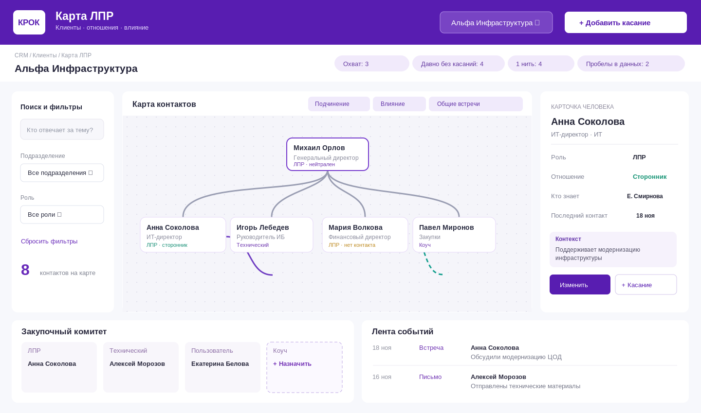

# КРОК · Карта ЛПР — MVP

Кликабельный frontend-макет для кейса «Алло, бизнес»: интерактивная карта лиц, влияющих на принятие решений внутри корпоративного клиента.



**Статус:** итерация 1, демонстрационный MVP; вымышленные данные, **без подключения к CRM и без backend**. Макет предназначен для обсуждения дизайна и сценариев с командой. Реальные данные КРОК не используются.

## Запуск локально

Требования: **Node.js 18+** (npm идёт вместе с Node). Устанавливать зависимости **не нужно**.

```bash
npm run dev
```

Откройте `http://localhost:4173` в браузере. Если порт занят, можно задать другой: `PORT=4300 npm run dev` (macOS/Linux) или `$env:PORT=4300; npm run dev` (PowerShell).

Тесты:

```bash
npm test
```

## Что можно попробовать

1. Выберите клиента в фиолетовой верхней панели.
2. Кликните на человека в центре: справа появится его карточка, история и отношение к КРОК.
3. Потяните карточку мышью — **плавные линии (кубические кривые Безье)** перестроятся, а позиции сохранятся в браузере.
4. Добавьте нового человека кнопкой «+ Контакт» или переключите типы линий: «Подчинение», «Влияние», «Общие встречи».
5. Попробуйте поиск, фильтры и четыре счётчика (нажатие применяет соответствующий фильтр).
6. Нажмите «Изменить», «+ Добавить касание» или «+ Связь» — новые данные появятся в интерфейсе.
7. Назначьте участника в свободный слот закупочного комитета.
8. Нажмите «Вернуть демоданные», чтобы начать показ заново.

Данные остаются в `localStorage` **только конкретного браузера**. Они не отправляются ни на какой сервер и не синхронизируются между участниками команды. Кнопки/фильтры работают с тестовыми данными; аналитических прогнозов и AI нет.

## Структура проекта

```text
index.html                      Точка входа
src/main.js                     Экран, карточки, действия, формы
src/styles.css                  Оформление и адаптивная сетка
src/model.js                   Фильтрация и проверка сущностей
src/graph/curves.js            Плавные SVG-связи (кривые Безье)
src/data/seed.js               Вымышленные данные
src/data/repository.js         MockRepository + localStorage
scripts/dev-server.mjs         Локальный HTTP-сервер Node
tests/model.test.mjs            Модульные тесты
assets/layout-mockup.svg       Редактируемый рисунок будущего UI
assets/layout-mockup.png       Изображение для обсуждения дизайна
docs/01_...md                  Подробная UI-спецификация
docs/02_...md                  Архитектура и переход к backend
```

## Почему не React прямо сейчас?

Для **первого кликабельного макета** использованы нативные HTML/CSS/JS без установки пакетов. Это позволяет открыть и дорабатывать макет даже без сборки. При переходе к большому приложению можно перенести части `main.js` в React-компоненты и заменить SVG на React Flow — **не выдавая этот переход за уже реализованный**.

## Границы MVP

Уже есть базовый цикл **выбор клиента → интерактивная карта → карточка и связи → редактирование → сохранение касания**.

Пока **нет**: реальной CRM, backend/API, AI и сложной аналитики, автоматического сбора писем, экспорта Excel/PDF, отдельных прав доступа, полноценного дерева отделов, автопрокладки «пути знакомства» и полноценного опроса с условными вопросами. Эти возможности остаются в backlog.

## Публикация на GitHub

Папка подготовлена для Git. Если она ещё не привязана к удалённому репозиторию:

```bash
git init
git add .
git commit -m "feat: clickable KROK LPR map MVP"
git branch -M main
git remote add origin https://github.com/<USERNAME>/<REPOSITORY>.git
git push -u origin main
```

Замените `<USERNAME>` и `<REPOSITORY>` на реальные значения. Для публикации потребуется доступ к вашему репозиторию GitHub. Не добавляйте токены, ключи доступа и реальные данные клиентов в код.

## Дизайн и техническое задание

- [Интерфейс MVP](docs/01_КРОК_Карта_ЛПР_Интерфейс_MVP.md)
- [Внутренняя архитектура](docs/02_КРОК_Карта_ЛПР_Техническая_архитектура_MVP.md)
