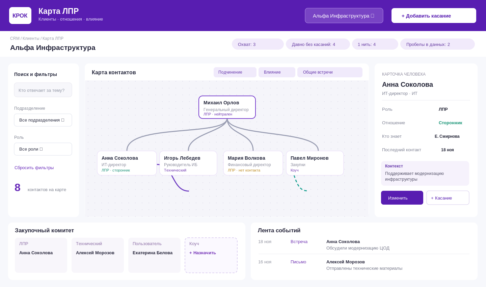

# «Карта ЛПР» для КРОК — спецификация веб-интерфейса MVP

**Версия:** 1.1 · **Статус:** спецификация и первый запускаемый кликабельный макет  
**Адресат:** UX/UI-дизайнер, frontend-разработчик, тестировщик, команда кейс-чемпионата  
**Основа:** материалы команды (эскиз одного экрана, схема сбора → дополнения → использования информации, карточка контакта, закупочный комитет, опрос после встречи) и обязательные функции кейса КРОК.

> **Границы этой версии.** Создаём интерактивный, кликабельный MVP на тестовых данных: кнопки, фильтры, раскрытие карточек, заполнение форм, изменение связей и демонстрационные сценарии работают в браузере. **Не делаем** реальную интеграцию с CRM, сервер, AI, сложную аналитику, парсинг почты и внешних источников. Реальные подключения — следующий этап.

---


## Актуальный визуальный макет (итерация 1)



**Исходник, который можно редактировать:** `assets/layout-mockup.svg`. **Сравнение с эскизом команды:** фиолетовая верхняя полоса, крупное центральное поле карты, карточка выбранного человека справа и нижний информационный блок сохранены. Для выполнения кейса добавлена компактная левая панель фильтров. В макете связи специально изображены плавными дугами, а не прямыми стрелками.

### Что уже работает в первом демопрототипе

- Выбор двух вымышленных клиентов, смена контактов, поиск по имени/должности/теме и фильтры по отделам и ролям.
- Выделение узла, просмотр карточки, истории и статуса отношения к КРОК.
- SVG-кривые Безье трёх типов: подчинение, влияние и общая работа; переключение слоёв; изменение расположения узлов мышью; масштабирование.
- Создание и редактирование контакта, добавление связи и касания, назначение ролей закупочного комитета.
- Четыре демонстрационных индикатора на основе локальных данных: охват, давно без касаний, одна «нить», пробелы.
- Сохранение в `localStorage` и сброс тестового набора.

**Не реализовано в данной итерации:** подключение CRM и backend, выгрузка, умный «путь знакомства», сложные алгоритмы аналитики, импорт из почты/календаря, полноценное дерево подразделений, автоцентрирование по поиску и полноценный поствстречный многошаговый опрос. Форма «Добавить касание» пока упрощена. Макет не является финальным UI и будет дорабатываться.

## 1. Цель интерфейса

Помочь сотруднику КРОК за несколько действий увидеть, **кто у корпоративного клиента принимает решение, кто на него влияет, с кем уже общается КРОК и что известно о последних взаимодействиях**. После встречи сотрудник должен легко пополнить карту знаниями, не заполняя длинную CRM-форму.

**Продуктовый принцип:** «Один экран — одна картина клиента». По умолчанию показываем только полезный для выбранной темы/подразделения срез, а не все 500 контактов сразу.

### Основные роли пользователей

- **Продажи:** готовятся к встрече, ищут ЛПР и путь знакомства, фиксируют результат.
- **Маркетинг:** видят темы и интересы контактов для адресных коммуникаций.
- **Проектная/техническая команда:** видят пользователей и технических экспертов, дополняют знания.
- **Руководитель:** оценивает видимость значимых ролей и зависимость от отдельных контактов.

В MVP не нужны отдельные интерфейсы под каждую роль: один экран и переключение контекста достаточны.

## 2. Карта экранов

**Экран А — выбор клиента.** Список из 2–3 вымышленных компаний; поле поиска; действие «Открыть карту». Имитация входа из карточки компании CRM.

**Экран Б — «Карта ЛПР» (основной).** Главный экран с пятью зонами:

```text
┌────────────────────────────────────────────────────────────────────────────────────────────────┐
│  КРОК / Клиенты / [Компания ▾]       [Кто отвечает за тему? 🔎]        [Добавить касание]     │
│  [Охват]  [Давно не было касаний]  [«1 нить»]  [Пробелы в данных]                            │
├─────────────────┬──────────────────────────────────────────────────┬───────────────────────────┤
│ СЛЕВА           │ ЦЕНТР: КАРТА КЛИЕНТА                             │ СПРАВА: КАРТОЧКА          │
│ Направления     │ Дерево подразделений / сотрудники                │ ФИО, должность, отдел      │
│ ИБ / Облако     │ Узлы-карточки и линии связей                     │ Роль в решении            │
│ ЦОД / ИИ        │ Масштаб +/−, перемещение, легенда               │ Отношение к КРОК          │
│ Подразделения   │ [Роли] [Влияние] [Общие встречи] [Свежесть]       │ Кто из КРОК знает         │
│ Фильтры         │ [Путь знакомства] (ручное отображение)           │ Контакты и история        │
│                 │                                                  │ [Изменить] [Новое касание]│
├─────────────────┴──────────────────────────────────────────────────┴───────────────────────────┤
│ ЗАКУПОЧНЫЙ КОМИТЕТ: [ЛПР] [Технический] [Пользователь] [Коуч]  (пустой слот пунктиром)      │
├────────────────────────────────────────────────────────────────────────────────────────────────┤
│ ЛЕНТА СОБЫТИЙ: встреча / письмо / уточнение / обновление карточки; кликабельные записи        │
└────────────────────────────────────────────────────────────────────────────────────────────────┘
```

**Экран/модальное окно В — опрос после встречи.** Быстрый ввод информации на 2–3 минуты **как целевой UX-ориентир, а не измеренный показатель**. Все необязательные вопросы можно пропустить.

**Экран/модальное окно Г — редактирование контакта или связи.** Изменение роли, зоны ответственности, влияния, отношения, заметки, источника и даты подтверждения.

Это **не четыре отдельные большие страницы**: основной опыт строится вокруг экрана Б, остальное открывается модально или в боковой панели.

## 3. Верхняя панель основного экрана

| Элемент | Что видно | Что происходит при клике в MVP |
|---|---|---|
| Выбор компании | Название текущего клиента | Переключает тестовую компанию и данные карты |
| Поиск «Кто отвечает за тему?» | Поле поиска по ФИО, должности, подразделению, теме | Подсвечивает совпадения, позволяет выбрать контакт |
| «Охват» | Условный счётчик контактов с указанной ролью и касанием за последние 90 дней | Открывает список таких контактов (простая фильтрация тестовых данных) |
| «Давно не было касаний» | Число контактов, с которыми нет касаний более 90 дней | Фильтр контактов по дате последнего события |
| «1 нить» | Люди клиента, которых знает только один сотрудник КРОК | Фильтр по количеству внутренних связей |
| «Пробелы в данных» | Число карточек с пустыми обязательными полями | Список карточек для ручного заполнения |
| «Добавить касание» | Основная кнопка действия | Открывает форму короткого опроса/события |

**Важно:** четыре счётчика — простые вычисления по демонстрационному набору, без предиктивной аналитики и оценки бизнес-рисков. Если подсчёт ещё не реализован, в первой визуальной итерации допускаются фиксированные демо-значения с пометкой «демо».

## 4. Левая панель: контекст и фильтры

**Направления:** «Все», «Информационная безопасность», «Облако», «ЦОД», «ИИ», «Инфраструктура» (набор демонстрационный). Список подразделений клиента: ИТ, ИБ, Финансы, Закупки, Бизнес и др. Поиск в списках.

**Фильтры:**

- роль в принятии решений: ЛПР / технический эксперт / пользователь / коуч / неизвестна;
- отношение к КРОК: сторонник / нейтрален / скептически настроен / неизвестно;
- наличие взаимодействий: были / не были / давно не было;
- заполненность данных: все / есть пробелы;
- «знаком через КРОК»: известен конкретному сотруднику / неизвестен команде;
- подразделение и выбранная тема.

Нужны кнопки «Сбросить фильтры» и «Показать всех в этом подразделении». В MVP фильтрация сразу меняет видимые узлы карты; рядом указывается количество показанных людей из общего числа.

**Большой клиент (сотни контактов):** по умолчанию показывать выбранное направление или подразделение; не обещать отрисовку 500 карточек на одном экране. Дополнительная фильтрация «по сделке» — **после MVP**.

## 5. Центральная панель: карта людей

### 5.1. Вид узла-карточки

Каждая карточка на схеме содержит:

- имя и фамилию;
- должность или короткую подпись;
- подразделение;
- значок роли: **ЛПР / Технический / Пользователь / Коуч / Роль неизвестна**;
- цветовую метку отношения к КРОК с текстовой подписью (не полагаться только на цвет);
- визуальное указание, что контакт давно не обновлялся, **если такая дата есть**.

Внутри узла не выводить все заметки: подробности — справа.

### 5.2. Типы линий (НЕ смешивать)

1. **Организационная связь «подчиняется»** — базовое дерево: кто кому подчиняется.
2. **Связь «влияет на решение»** — отдельная линия/стрелка с подписью и направлением.
3. **Связь «совместная работа / совместные встречи»** — отдельный тип линии с подписью; если факт совместных встреч известен из тестовых событий.
4. **«Кто из КРОК знает человека»** — выводить как поле в карточке и в режиме «Путь знакомства», **не путать** с отношениями между сотрудниками клиента.

**Гибкость линий:** только плавные соединения (кубические кривые Безье), без прямых стрелок и без наложения на текст. На наведении подсветить связь и показать её тип; на клике вывести краткое описание и источник. В текущем макете связи построены на SVG `<path>` с кубическими кривыми Безье (`C`). Их геометрия вычисляется в `src/graph/curves.js` и обновляется при перетаскивании узлов. При росте проекта можно заменить реализацию на React Flow без изменения пользовательского сценария.

### 5.3. Режимы карты

- **По подразделениям** — режим по умолчанию: иерархия в читаемом виде.
- **Выделить роли** — контрастность значков ЛПР, экспертов и других ролей.
- **Выделить влияние** — показываем только заведённые вручную связи «влияет на».
- **Общие встречи** — подсвечиваем известные совместные взаимодействия из тестовых данных.
- **Свежесть данных** — визуально ослабляем давно не обновлявшиеся карточки.
- **Путь знакомства** — выделяем, кто из сотрудников КРОК знаком с выбранным человеком и какие подтверждённые связи есть; **автоматический поиск оптимального маршрута не нужен в MVP**.

Режимы можно реализовать как переключатели видимости слоёв без сложной аналитики. При нажатии на узел: выделить контакт, затем заполнить правую панель. При нажатии на пустое место: снять выделение. Поддержать zoom, pan, кнопку «Вписать в экран» и легенду.

## 6. Правая панель: карточка выбранного человека

**Состояние без выбора:** «Выберите человека на карте, чтобы увидеть его профиль». 

**При выборе показать блоки:**

| Блок | Содержимое MVP |
|---|---|
| Профиль | ФИО, должность, подразделение, зона ответственности |
| Роль в решении | ЛПР / технический / пользователь / коуч / неизвестно; контекст выбранной темы |
| Отношение к КРОК | Сторонник / нейтрален / скептически настроен / неизвестно (ручная оценка) |
| Влияние | Уровень: высокое / среднее / низкое / неизвестно (ручная оценка) |
| Кто из КРОК его знает | ФИО ответственного и известных сотрудников КРОК |
| Связи | Руководитель, подчинённые, влияние, связи с коллегами |
| История | Последние встречи/касания с датами и краткими заметками; кнопка «Показать всю историю» |
| Контекст общения | Рабочие интересы/темы, предпочитаемый стиль общения, договорённости, следующий шаг |
| Качество данных | Источник, автор записи, дата изменения/подтверждения, недостающие поля |

**Кнопки:** «Редактировать», «Добавить касание», «Добавить связь», «Кого попросить познакомить» (в MVP просто раскрывает список связанных сотрудников КРОК), «Закрыть карточку».

**Честность данных:** если роль, отношение или стиль общения не указаны, писать «Неизвестно», а не придумывать. Субъективные оценки отмечать как мнение конкретного сотрудника с датой. Источник «CRM», «Заполнено сотрудником», «Результат опроса».

**Возраст/поколение, личные симпатии, личные соцсети:** встречались среди черновых пожеланий, но в MVP не включать как обязательные поля. Они не нужны для основной бизнес-задачи и требуют отдельного обсуждения допустимости и источников данных. Предпочтение — профессиональному контексту.

## 7. Нижняя зона: закупочный комитет и лента

### 7.1. Четыре места в закупочном комитете

Карточки-слоты: **ЛПР***, **Технический***, **Пользователь***, **Коуч***. При наведении на `*` показывается краткая расшифровка роли.

- Если человек указан, показаны его ФИО и ссылка на карточку.
- Если слот пуст, он обозначен **пунктиром** и текстом «Не определён».
- Клик по слоту — выбор контакта из текущей компании или «Оставить пустым».
- Состав комитета привязан к **выбранной теме** (а не автоматически ко всей компании). Для привязки к конкретной сделке потребуется следующая итерация.
- **Никаких автоматических назначений:** команда вручную отмечает известные роли.

### 7.2. Лента событий

Список датированных событий: встреча, письмо, вебинар, исследование, изменение контакта, запись после встречи. Каждая строка содержит дату, тип, имя контакта и краткую суть. Нажатие выбирает контакт и открывает соответствующую запись. Сверху фильтр «Все / По выбранному контакту».

Демонстрационная кнопка «Сымитировать новое касание из CRM» добавляет тестовое событие и подсвечивает затронутую карточку. Это **только симуляция**, не подключение к почте/календарю.

## 8. Опрос после встречи (MVP)

Цель — **не заставлять сотрудника заполнять всю карточку**, а дать сохранить то, что он узнал.

**Триггеры:** кнопка «Добавить касание» в шапке/карточке и тестовая симуляция нового события.  
**Форма:**

1. С кем общались? Выбор контакта (если нет — «Создать нового»).
2. Дата и формат встречи (заполняются демонстрационными значениями, можно изменить).
3. Что стало известно? Необязательные вопросы: роль в решении, отношение к КРОК, стиль общения, с кем советуется/кого рекомендует, договорённости, следующий шаг.
4. Краткая заметка и источник «со слов сотрудника».
5. Кнопки **«Сохранить», «Пропустить необязательные вопросы», «Отмена»**.

**После сохранения:** новая запись появляется в ленте и истории человека; заполненные сведения — в его карточке; в метаданных видны автор и дата; карта не теряет текущий выбор. Если ответ содержит только заметку — ничего не выводить о роли или влиянии автоматически.

## 9. Все основные клики: таблица поведения

| Где | Действие | Ожидаемый результат на тестовых данных |
|---|---|---|
| Выбор клиента | Выбрать компанию | Подгружается её отдельная демо-карта |
| Поиск | Ввести имя/должность/тему | Список результатов и фокус на выбранном узле |
| Левый фильтр | Выбрать «ИБ» | В карте остаются подходящие контакты |
| Узел | Нажать на человека | Узел выделяется, справа открывается карточка |
| Линия | Нажать на связь | Показывается тип связи, примечание и источник |
| Кнопка «Редактировать» | Изменить роль/отношение | После «Сохранить» значения обновляются в карточке и узле |
| Кнопка «Добавить связь» | Выбрать двух людей и тип связи | На графе появляется линия нужного типа |
| Комитет | Нажать на пустой слот | Открывается выбор контакта; слот заполняется |
| Лента | Выбрать событие | Выделяется соответствующий контакт и запись |
| Опрос | Сохранить заметку | Запись попадает в историю и ленту |
| «1 нить» | Нажать на счётчик | Показываются люди, которых знает лишь один сотрудник КРОК |
| «Пробелы» | Нажать на счётчик | Показываются карточки с незаполненными ключевыми полями |
| «Сбросить демо» | Подтвердить сброс | Возвращаются исходные тестовые данные |

## 10. Состояния, которые обязательно нарисовать

1. Компания выбрана, контакт не выбран.
2. Выбран контакт с заполненными данными.
3. Контакт с пробелами: «Неизвестно» и кнопка «Дополнить».
4. Поиск/фильтры не дали совпадений: «Нет контактов по условиям» + сброс.
5. Пустое место в комитете.
6. Опрос после встречи: до заполнения → успешно сохранено.
7. Не сохранены изменения: подтверждение при закрытии формы.
8. Длинная схема: виден выбранный раздел, а не хаотичная «простыня».

**Визуальный стиль:** спокойный корпоративный; светлая или тёмная тема — по решению команды. Цвета должны дублироваться текстом/иконками. Читаемые подписи на линиях и узлах, отдельное состояние наведения и выбора; управление клавиатурой для основных кнопок/форм. На узких экранах правая карточка может становиться выдвижной панелью; MVP ориентирован прежде всего на ноутбук/десктоп.

## 11. Сценарий демонстрации на защите

1. Открываем тестовую компанию → выбираем тему «Информационная безопасность».
2. Через поиск находим технического эксперта → видим влияние на ЛПР и прошлые касания.
3. Смотрим, кто из сотрудников КРОК знаком с ним и кто отвечает за контакт.
4. Находим **пустой** слот закупочного комитета → вручную заполняем его.
5. Имитируем встречу → проходим короткий опрос → видим новую запись в ленте и изменённую карточку.
6. Нажимаем «Пробелы в данных» → демонстрируем, какие сведения ещё не подтверждены.

**Результат:** зритель видит полный цикл «увидел → понял → дополнил», даже без backend и AI.

## 12. Что не входит в текущий MVP

- Подключение к реальной CRM КРОК и настоящая двусторонняя синхронизация.
- AI-рекомендации, автоматический поиск влияния, прогноз успеха сделок и оценка «рисков» по модели.
- Анализ переписок, календарей, новостей, соцсетей и любых внешних персональных источников.
- Автоматические цепочки знакомств, алгоритмы оптимального пути и приписывание людям неустановленных ролей.
- Экспорт PDF/XLSX/CSV и полноценный дашборд по сделке.
- Сложная система прав доступа, корпоративная аутентификация и многопользовательское редактирование.

**В следующей итерации:** API/CRM, права доступа, экспорт, фильтр по конкретной сделке, правила сигналов изменений; только затем — возможные AI-функции.

## 13. Критерии приёмки именно интерфейса

- Все **7 обязательных функций кейса** можно показать без объяснения «тут потом будет кнопка»: выбор клиента, карта, связи, оценка отношений, история, редактирование, фильтры.
- Клик по узлу открывает верную карточку, клик по событию — верную историю.
- Данные, изменённые в форме, **сразу отражаются** в узле, карточке и связанных блоках.
- Пустые поля не подменяются догадками и чётко различаются с заполненными.
- Пользователь может повторить демонстрацию через «Сбросить демо».
- Все основные действия выполняются с тестовыми данными локально, без регистрации и реальной CRM.

---

### Открытые решения для команды

1. Светлая или тёмная тема; точное оформление узлов и значков.
2. Закупочный комитет в MVP — по выбранной **теме**, в будущем — по конкретной сделке.
3. Нужна ли в первом прототипе отдельная кнопка «Создать контакт», или достаточно её внутри опроса.
4. Какие профессиональные поля считать обязательными: предварительно ФИО, должность, подразделение, роль/«неизвестно», ответственный, источник.
5. Сохранять демонстрационные изменения при перезагрузке или сбрасывать: технический документ предлагает `localStorage` + «Сбросить демо».
