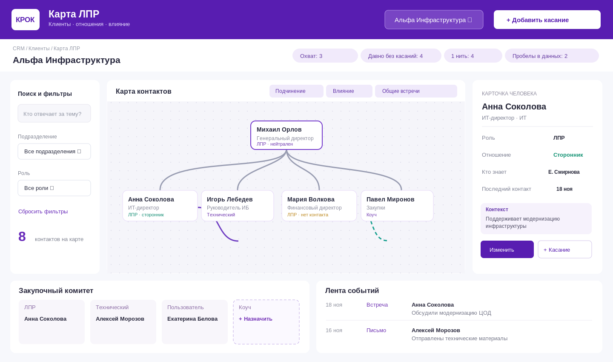

# «Карта ЛПР» для КРОК — внутренняя архитектура и план реализации MVP

**Версия:** 1.1 · **Статус:** архитектура и фактическая структура запускаемого прототипа  
**Цель:** описать, как организовать код, тестовые данные и взаимодействия **до** подключения backend.  
**Связанный документ:** `01_КРОК_Карта_ЛПР_Интерфейс_MVP.md`.

> **Решение на текущем этапе:** frontend-приложение на тестовом наборе данных; действия пользователя реально меняют состояние интерфейса, но все операции остаются в браузере. Будущий CRM API подключается через заменяемый слой данных. Никакой реальной CRM, AI и бизнес-аналитики в этой версии.

---

## 1. Технологический подход

**Фактический стек первого работающего макета:**

- **HTML + CSS + JavaScript ES Modules** — без установки сторонних пакетов и сборки; приложение запускается из `npm run dev` через встроенный Node.js HTTP-сервер.
- **SVG + cubic Bézier (`C`)** — гибкие изогнутые связи с динамическим пересчётом при перемещении узлов. Исходник `src/graph/curves.js`.
- **Состояние `ui` + функция `render()`** в `src/main.js` — рендер шапки, фильтров, карты, правой карточки, комитета и событий. Для MVP это один явный модуль, позже его можно разделить на React-компоненты.
- **`src/model.js`** — селекторы, фильтры, статусы, проверка связей.
- **`MockRepository` + `localStorage`** — имитация хранения CRM и пользовательских правок. Seed вымышленный; реального API нет.
- **Node.js 18+**, без npm-зависимостей. Проверка моделей: `npm test`.

**Дальнейшая эволюция (НЕ реализована):** при увеличении числа компонентов можно перевести интерфейс на React + TypeScript + Vite, а граф — на React Flow. Это не требуется для текущего кликабельного прототипа.

**Почему не backend сейчас?** Пользовательская задача — сначала сделать кликабельный продукт, проверить UX и структуру данных. Сервер не нужен, чтобы демонстрировать выбор людей, фильтры, редактирование и опрос.

## 2. Схема внутренних компонентов

```text
                   [Главная страница / Выбор клиента]
                                   │
                         [Страница «Карта ЛПР»]
                                   │
                  ┌────────────────┼─────────────────┐
                  │                │                 │
          [Левая панель]     [Граф/карта]      [Правая карточка]
                  │                │                 │
                  └────────────────┼─────────────────┘
                                   │
               [Комитет]  [Лента]  [Форма касания/редактор]
                                   │
                            [Хранилище UI]
                  (выбранный клиент, узел, фильтры,
                     слои карты, открытые модальные)
                                   │
                      [Сервис сценариев / actions]
                                   │
                    [Интерфейс репозитория данных]
                                   │
                   ┌───────────────┴───────────────┐
                   │                               │
           СЕЙЧАС: MockRepository             ПОТОМ: ApiRepository
             JSON + localStorage               HTTP ↔ backend ↔ CRM
```

**Ключевой принцип:** UI-компонент не читает JSON напрямую и не вызывает `fetch` самостоятельно. Он обращается к репозиторию через импорт `MockRepository` и локальную модель. Так mock можно будет заменить HTTP-запросами, не переписывая карту.

## 3. Сущности данных

Сущности должны различать **клиентов, людей клиента, сотрудников КРОК, отношения между людьми и события**.

| Сущность | Для чего | Минимальные поля |
|---|---|---|
| `Company` | Корпоративный клиент | `id`, `name`, `industry?` |
| `Department` | Организационный отдел клиента | `id`, `companyId`, `name`, `parentDepartmentId?` |
| `Contact` | Человек у клиента | `id`, `companyId`, `departmentId?`, `fullName`, `title`, `managerContactId?`, `topics[]`, `meta` |
| `KrokEmployee` | Сотрудник КРОК | `id`, `fullName`, `team`, `demoRole?` |
| `StakeholderProfile` | Оценка роли человека **по теме** | `contactId`, `topicId`, `decisionRole`, `attitude`, `influence`, `communicationStyle?`, `responsibility?`, `meta` |
| `PersonRelation` | Связь **между двумя людьми клиента** | `id`, `fromContactId`, `toContactId`, `type`, `note?`, `meta` |
| `InternalConnection` | Кто из КРОК знает человека / курирует его | `id`, `employeeId`, `contactId`, `type`, `meta` |
| `Interaction` | Касание клиента | `id`, `companyId`, `contactIds[]`, `employeeIds[]`, `date`, `kind`, `summary`, `source`, `meta` |
| `CommitteeSlot` | Роль в закупочном комитете | `companyId`, `topicId`, `role`, `contactId` (или `null`) |
| `Topic` | Направление: ИБ, облако, ЦОД и т.п. | `id`, `title` |
| `DataMeta` | Происхождение и подтверждение сведений | `source`, `updatedAt`, `updatedBy?`, `verifiedAt?` |

### 3.1. Типы, которые нельзя смешивать

**Типы `PersonRelation.type`:**

- `reports_to` — организационное подчинение;
- `influences` — влияет на решение;
- `works_with` — рабочее взаимодействие между контактами.

**Типы `InternalConnection.type`:** `knows`, `responsible_for`.

**Типы `StakeholderProfile.decisionRole`:** `decision_maker` (ЛПР), `technical`, `user`, `coach`, `unknown`.

**Типы `StakeholderProfile.attitude`:** `supporter`, `neutral`, `skeptical`, `unknown`.

**Типы `Interaction.kind`:** `meeting`, `email`, `event`, `research`, `note`.

У **одного человека** роль может отличаться по выбранной теме и позже — по сделке. Не делаем глобальное поле `isLPR: true` в `Contact`: оно приведёт к неверным выводам.

### 3.2. Источник данных и история изменений

Нужны `source` и `updatedAt` хотя бы на уровне записи, например: `crm_mock`, `manual`, `post_meeting_survey`. Для ручных оценок хранить автора, дату и пометку о субъективности. В первой версии **не** делаем полноценный журнал аудита каждого изменения; при расширении backend его нужно добавить.

`unknown` / `null` — нормальное состояние. Система не приписывает человеку отношение к КРОК или влияние без вручную внесённых сведений.

## 4. Пример демо-данных

Для MVP достаточно:

- **2 вымышленных компании**, чтобы продемонстрировать выбор клиента;
- **10–15 контактов на компанию**, а не 500 одновременно;
- **4–6 подразделений** у основного клиента;
- **2–4 сотрудника КРОК**, знакомых с разными людьми;
- **10–20 событий** разного типа, с понятными датами;
- **5–10 связей** между людьми клиента, включая 1–2 связи влияния;
- **4 слота комитета**, из которых минимум один не заполнен;
- **2 контакта с пропущенными данными**, 1 контакт с давно не подтверждённой информацией, 1 контакт категории «1 нить».

Даты касаний задавать относительно текущей даты либо согласованной даты демо, чтобы счётчик «90 дней» не стал бессмысленным через месяц.

Не использовать настоящие персональные сведения сотрудников/клиентов КРОК. Имена и компании — тестовые.

## 5. Состояние приложения (state)

### 5.1. Данные предметной области (domain state)

`companies`, `departments`, `contacts`, `stakeholderProfiles`, `personRelations`, `internalConnections`, `interactions`, `topics`, `committeeSlots`, `krokEmployees`.

### 5.2. Временное состояние интерфейса (UI state)

- `selectedCompanyId`;
- `selectedTopicId`;
- `selectedContactId` и `selectedRelationId`;
- `searchQuery`;
- `filters` (роль, подразделение, отношение, давность касания, пробелы);
- `visibleEdgeTypes` (подчинение, влияние, рабочие связи);
- `activeView` (по подразделениям / роли / встречи / свежесть);
- `isContactEditorOpen`, `isSurveyOpen`, `isCommitteeEditorOpen`;
- `pendingDraft`, `hasUnsavedChanges`;
- `highlightedContactIds` (например, после имитации события).

**Правило:** смена компании должна очищать выбранный контакт, открытые карточки и фильтры, не относящиеся к новой компании. Смена темы — менять профиль ролей и состав комитета, но не терять историю людей.

### 5.3. Хранение

Начальные данные — из `seed.ts`/JSON. Изменения — через единый репозиторий с сохранением в `localStorage` под версионированным ключом, например `krok-lpr-mvp-v1`. Кнопка «Сбросить демо» очищает локальные изменения и загружает начальные данные. Это **не** совместная работа и **не** синхронизация с CRM.

## 6. Реальная структура созданной папки

```text
krok-lpr-mvp/
├── index.html                   # HTML-контейнер страницы
├── package.json                 # команды dev, start, test
├── README.md                    # инструкция по запуску и возможностям
├── .gitignore                   # исключения для git
├── src/
│   ├── main.js                  # рендер интерфейса, кнопки и формы
│   ├── styles.css               # фиолетовая тема, карточки, сетка
│   ├── model.js                 # доменная модель и фильтрация
│   ├── graph/
│   │   └── curves.js            # кубические кривые Безье
│   └── data/
│       ├── seed.js              # тестовая база: компании, люди, события
│       └── repository.js        # MockRepository, localStorage
├── scripts/
│   └── dev-server.mjs           # локальный сервер, без зависимостей
├── tests/
│   └── model.test.mjs           # автоматические модульные тесты
├── assets/
│   ├── wireframe-reference.png  # исходный эскиз команды
│   ├── layout-mockup.svg        # редактируемый подробный макет
│   └── layout-mockup.png        # просмотр макета
└── docs/
    ├── 01_КРОК_Карта_ЛПР_Интерфейс_MVP.md
    └── 02_КРОК_Карта_ЛПР_Техническая_архитектура_MVP.md
```



### Действующая схема модулей

```text
index.html + styles.css
        │
     main.js ────────────→ ui: компания, узел, фильтры, слои, модалки
        │
        ├──→ model.js ──→ поиск, проверки, простые счетчики
        ├──→ curves.js ─→ SVG: M ... C ... (плавные связи)
        └──→ MockRepository ──→ seed.js → localStorage

Потом: MockRepository заменяется/дополняется ApiRepository → backend → CRM.
```

**Важно для backend:** не привязывать API к координатам графа. У CRM — люди и история, у карты — типы связей, оценки и раскладка. Разделение источников данных уточняется на этапе проектирования API.

## 7. Слой данных: контракт до backend

Условный `LprRepository` — единственная точка доступа к данным. В MVP его реализует `MockRepository`.

```ts
interface LprRepository {
  listCompanies(): Promise<Company[]>;
  getCompanyMap(companyId: string): Promise<CompanyMapData>;
  updateStakeholderProfile(patch: StakeholderPatch): Promise<StakeholderProfile>;
  createContact(input: NewContact): Promise<Contact>;
  createRelation(input: NewRelation): Promise<PersonRelation>;
  createInteraction(input: NewInteraction): Promise<Interaction>;
  setCommitteeSlot(input: CommitteeSlotUpdate): Promise<CommitteeSlot>;
  resetDemoData(): Promise<void>;
}
```

*Названия `CompanyMapData`, `StakeholderPatch` и прочих DTO — проектные, их точные поля уточняются вместе с `types.ts`. Здесь фиксируется **идея контракта**, а не готовый компилируемый код.*

Объекты для карты (`nodes`, `edges`) формируются из нормализованных сущностей **отдельной функцией**, а не хранятся как единственный источник правды. Позиции узлов — UI-представление; реальные связи и значения находятся в domain data.

### Что приходит из «CRM» и что добавляет карта

| Данные | Для текущего mock-MVP | Куда в будущем |
|---|---|---|
| Компания, сотрудник клиента, должность, подразделение | Имитируются в `seed.ts` | Чтение из CRM |
| Касания, встречи, события | Имитируются в `seed.ts` + ручное добавление | Чтение из CRM и запись новых событий по правилам интеграции |
| Связи влияния, оценка отношений, стиль общения | Ручное редактирование в приложении | Хранение в модуле карты / согласованные поля CRM |
| Изменение ответственного и дополняющие заметки | Локальные изменения | Синхронизация через API после согласования владельцев данных |
| Состав закупочного комитета | Ручное заполнение | Возможно, привязка к сделке/проекту в CRM |

**Учитывать конфликты в будущем:** CRM — предполагаемый источник базовых данных о человеке, карта — источник дополнительных оценок и связей. Пока не пытаться автоматически разрешать противоречия между источниками.

## 8. Основные пользовательские операции как функции

| Операция | Что меняет | Что обновляется на экране |
|---|---|---|
| `selectCompany` | Текущая компания и контекст | Схема, фильтры, лента, комитет |
| `selectContact` | `selectedContactId` | Подсветка узла, правая панель |
| `applyFilters` | UI-фильтры | Видимость узлов и связанных линий |
| `toggleEdgeLayer` | Список типов связей | Видимые линии и подписи |
| `editStakeholder` | Профиль роли/отношения/влияния | Правая карточка, бейдж узла, пробелы |
| `addPersonRelation` | `personRelations` | Новая линия нужного типа |
| `addInteraction` | `interactions`; при необходимости метаданные | Лента, история контакта, последний контакт |
| `setCommitteeSlot` | `committeeSlots` | Слот комитета и роль в выбранной теме |
| `simulateCrmTouch` | Тестовое событие | Строка ленты, подсветка карточки, счётчики |
| `resetDemo` | Восстановление исходного seed | Вся демонстрационная карта |

### Правила валидации (без аналитики)

- Нельзя сохранить контакт без ФИО и компании.
- Нельзя создать связь человека с самим собой.
- Нельзя связать людей **разных компаний** в оргструктуре одной компании.
- Не дублировать идентичную связь с теми же участниками и типом.
- Даты событий не должны быть ошибочно записаны в недопустимом формате.
- Необязательные поля опроса можно оставить пустыми.
- Состав комитета не должен указывать на удалённого/несуществующего человека.

## 9. Отдельно: карта как граф

**Вход:** список контактов выбранной компании, отделов, профилей и отношений.  
**Выход в текущем MVP:** массив видимых людей и отношений → HTML-карточки + SVG `<path>` с кубическими кривыми Безье. Для React Flow это впоследствии можно преобразовать в массив `nodes` и `edges`.

- **Узлы:** один узел на человека; координаты — по отделу/уровню подчинения. Для первой версии достаточно ручной или простой фиксированной раскладки.
- **Рёбра `reports_to`:** оргструктура (базовая схема).
- **Рёбра `influences`:** отдельный включаемый слой; подпись «влияет на решение».
- **Рёбра `works_with`:** отдельный включаемый слой; подпись «связь/общие встречи».
- **Связи с КРОК:** сначала через правую карточку/список; не добавлять сотрудников КРОК в дерево компании как обычные клиентские узлы.
- **Скрытие при фильтрации:** контакт исчезает или затемняется — согласовать один вариант. Базовый вариант: скрывать не совпадающие карточки и все рёбра к скрытым узлам.
- **Ручное добавление:** форма «Человек А → тип связи → Человек Б»; появление новой линии после сохранения.
- **Масштаб:** zoom, pan, центрирование; не загружать огромную схему целиком.

**Без алгоритмов:** не вычислять «силу влияния», «лучшую цепочку знакомств», «вероятность сделки» или «системный уровень доверия». Выводить только то, что заложено в тестовых данных и подтверждено человеком.

## 10. Опрос после встречи — внутренний поток

```text
Пользователь нажал «Добавить касание»
                ↓
Открылась форма → выбирает контакт (или создаёт нового)
                ↓
Заполнил только известные ответы → «Сохранить»
                ↓
Проверка обязательных полей (контакт / дата / тип события)
                ↓
createInteraction(...) → запись добавлена в локальный репозиторий
                ↓
Если вручную изменены роль/отношение/стиль — updateStakeholderProfile(...)
                ↓
Обновились история, лента, карточка и дата последнего касания
```

Если опрос пропущен, автоматически создавать новую оценку влияния или отношение **нельзя**. При конфликте с предыдущими ручными сведениями на первом этапе достаточно показать пользователю «Текущее значение / Новое значение» и запросить подтверждение замены. Автоматическое слияние — после MVP.

## 11. Простые вычисления, допустимые для MVP

Эти правила обслуживают отображение; **это не предиктивная аналитика**:

- **«1 нить»:** число уникальных `employeeId` из `InternalConnection` по контакту равно 1.
- **«Давно не было касаний»:** дата последнего события старше 90 дней (если событий нет — отдельное состояние «неизвестно»).
- **«Пробел»:** не заполнено одно из утверждённых ключевых полей; список правил хранить в конфигурации.
- **«Охват»:** доля контактов с известной ролью в выбранной теме, у которых было касание за 90 дней; знаменатель и правило для неизвестной роли вывести в подсказке.
- **Свежесть:** дата последнего подтверждения/изменения известна и превышает согласованный порог; не приравнивать отсутствие даты к «точно устарело».

На ранней стадии допустимы предзаданные значения на тестовых данных. Важнее одинаковая трактовка каждого индикатора по всему интерфейсу.

## 12. Порядок разработки без backend

| Шаг | Что сделать | Готово, когда… |
|---|---|---|
| **0. Каркас** | `index.html` + ES Modules + Node static server; выбор клиента в верхней панели | Сайт запускается локально; можно сменить компанию |
| **1. Модель данных** | Типы, 2 тестовые компании, сотрудники, связи, события, профиль, комитет | Демо-данные проходят простую проверку ссылок и ID |
| **2. Основной экран** | Шапка, левый фильтр, область схемы, правая панель, нижние блоки | Все зоны видны и корректно переключаются |
| **3. Граф и карточка** | Узлы, линии, выбор человека, zoom, pan, режимы слоёв | Можно увидеть связи гендиректора, руководителя и специалиста |
| **4. «Кнопочки» с состоянием** | Поиск, фильтры, счётчики, вкладки, комитет | Клики меняют данные/видимые компоненты, не являются заглушками |
| **5. Формы** | Изменение профиля, добавление связи, короткий опрос | Изменения видны на карте и в истории после сохранения |
| **6. Локальное сохранение** | `localStorage`, «Сбросить демо», проверки форм | Перезагрузка сохраняет изменения; сброс возвращает seed |
| **7. Полировка и тест** | Пустые состояния, подсказки, доступность, демосценарий | Сценарий защиты проходится от начала до конца без ошибок |

**Не начинать с AI и экспорта.** Приоритет — сквозной путь «открыть → найти → изменить → увидеть обновление».

## 13. Тестовые сценарии / критерии готовности

1. **Выбор компании.** Выбрать клиента Б → видно только его контакты, история клиента А не смешивается с Б.
2. **Поиск.** Найти «директор» → выбрать результат → карта фокусируется на верной карточке.
3. **Связи.** Переключить слой влияния → остаются только связи нужного типа; нажать на линию → видна подпись.
4. **Редактирование.** Сменить отношение на «нейтрален» → изменится текст и цвет метки, значение останется после перезагрузки.
5. **Пробелы.** Открыть карточку с неизвестной ролью → видно «Неизвестно»; заполнить → счётчик пробелов изменится (если правило это учитывает).
6. **Комитет.** Назначить человека в пустой слот → контакт откроется по нажатию на слот.
7. **Опрос.** Добавить касание с заметкой → оно появляется в истории и в ленте.
8. **«1 нить».** Нажатие фильтрует контакты по одному известному сотруднику КРОК.
9. **Сброс.** «Сбросить демо» → возвращается исходный набор без новых событий и изменений.
10. **Нет данных.** При пустом поиске/неполной карточке приложение не падает и не придумывает значения.

**Definition of Done для MVP:** все семь функций кейса демонстрируются; сценарий опроса работает; нет реальной зависимости от CRM; обновление данных отражается в нескольких частях UI; можно повторить показ.

## 14. Как позже подключить backend без переписывания интерфейса

На будущем этапе создаётся `ApiRepository` с реализацией тех же методов, что и `MockRepository`. После этого источник выбирается конфигурацией (например, `DATA_SOURCE=mock|api`). Frontend-компоненты остаются прежними.

**Предлагаемые REST-маршруты** (черновой контракт, не API КРОК):

```text
GET    /api/companies
GET    /api/companies/{companyId}/map?topicId=...
GET    /api/contacts/{contactId}
PATCH  /api/contacts/{contactId}/stakeholder-profile
POST   /api/contacts
POST   /api/relations
POST   /api/interactions
PUT    /api/companies/{companyId}/committee-slots/{role}
```

**Обязательные вопросы будущей интеграции:** авторизация, права доступа, CRM ID ↔ внутренний ID, дубли контактов, источник правды по каждому полю, обратная запись, конфликты правок, лог аудита, доступ к личным данным. Ни один из пунктов не нужно имитировать как «уже готовую корпоративную интеграцию».

## 15. Риски реализации и ограничения

| Риск | Что делаем в MVP |
|---|---|
| 500+ узлов делают карту нечитаемой | Показываем направление/подразделение, поиск, сворачивание веток; демо — 10–15 контактов |
| Смешение «кому подчиняется» и «кто влияет» | Разные типы рёбер, подписи и переключатели |
| Неправдивые оценки отношений | `unknown` по умолчанию; источник, автор и дата для ручной оценки |
| Несколько сотрудников знают одного человека | Отдельные `InternalConnection`, число «нитей» — без догадок |
| Данные быстро устаревают | Дата подтверждения и визуальный индикатор, без автоматического обновления |
| Сложная форма никто не заполнит | Короткий опрос с необязательными полями |
| Привязка ролей ко всей компании вводит в заблуждение | Профиль и комитет по выбранной теме; позже — по сделке |
| «Работает, пока открыт браузер» | `localStorage` и кнопка сброса; затем реальный backend |

## 16. Решения, которые стоит утвердить перед кодом

- **Роль/комитет:** по теме в MVP; уточнить, нужна ли в будущем привязка к конкретной сделке.
- **Карточка:** ФИО, должность, подразделение, профессиональная роль, отношения, источник, даты, связи и история — основа. Возраст и «поколение» не делать обязательными.
- **Граф:** сейчас SVG-кривые Безье с ручным расположением узлов; React Flow — возможное будущее улучшение.
- **Опрос:** сохраняет только известные ответы; не генерирует роль или отношения по тексту.
- **Сохранение:** `localStorage` на этапе MVP; интерфейс репозитория обязателен, чтобы заменить источник.
- **Демо:** вымышленные компании и люди; реальные персональные данные не использовать.

---

**Следующий практический шаг:** провести ручное сквозное тестирование браузера, улучшить UX перетаскивания и опроса, затем определить DTO/API и подключить backend. Пока макет работает только на тестовых данных.


## 17. Фактическая реализация и отклонения от целевой модели

В раннем архитектурном плане выше перечислены **целевые сущности**, рассчитанные на полноценный CRM-продукт. В первом кликабельном MVP данные сознательно упрощены:

| Фактический объект | Ключевые поля | Что появится позже |
|---|---|---|
| `companies` | `id`, `name`, `topic` | Идентификатор и справочники CRM |
| `people` | `id`, `companyId`, `name`, `position`, `department`, `role`, `attitude`, `influence`, `knows[]`, `topics[]`, `style`, `source`, `confirmedAt`, `x`, `y` | Разделить Contact, StakeholderProfile, InternalConnection и layout |
| `relations` | `source`, `target`, `kind`, `note` | Источники/подтверждение связей, история правок |
| `interactions` | `personId`, `date`, `type`, `summary`, `author` | Несколько участников и привязка к CRM-событиям |
| `committee` | `companyId`, `slot`, `personId` | Привязка к конкретной сделке/теме |

Текущий MVP хранит всё в одном объекте в `localStorage`. Это **демонстрационная модель**, а не рекомендованная схема промышленной БД.

**Ограничения текущего этапа:** нет управления правами, аутентификации, проверок данных CRM, совместного редактирования и сервера; `knows[]` содержит имена, а не IDs сотрудников КРОК; оценки влияния и отношения вводятся вручную, не вычисляются AI.

**Реализованные автоматические проверки:** структура выборки по компании, фильтрация, наличие пробелов, запрет некорректных связей, генерация кривых Безье, безопасное экранирование пользовательского текста. Проверки UX требуют ручного прогона в браузере.
