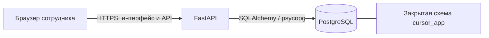

# Backend Cursor: база, доступ и онлайн-преддемо

Текущее состояние ветки `codex/cursor-backend`. Этот документ заменяет сведения о backend из документов 05–09. Изменения локальные: облако и GitHub ещё не обновлены.

## Как теперь работает приложение



FastAPI раздаёт интерфейс и проверяет каждый API-запрос. Браузер не получает пароль PostgreSQL или ключ service_role. Вход пока собственный, через серверные cookie-сессии, а не Supabase Auth. Supabase можно использовать как хостинг PostgreSQL; FastAPI размещается отдельно, например в контейнере на Railway. Конфигурации Dockerfile и railway.json подготовлены, но не опубликованы.

Локально без настроек остаётся SQLite. Теперь это новая база `.data/cursor-v2.sqlite3` с той же реляционной схемой. Старый `.data/cursor.sqlite3` не удалён. Пользователь подтвердил, что старые данные демонстрационные; аккаунт администратора новой базы создаётся заново. Указание пути к старой схеме вызывает понятную ошибку вместо её изменения.

## Что хранится в таблицах

| Таблица | Назначение |
| --- | --- |
| companies | Клиенты |
| people | Контакты: клиент, имя, роль, влияние, отношение |
| relations | Направленные связи с типом; оба контакта принадлежат одному клиенту |
| interactions | Встречи и другие касания |
| interaction_participants | Участники касаний |
| deals / deal_participants | Закупки и участники, когда закупки добавлены в карту |
| committee | Состав закупочного комитета, включая незанятые роли |
| users / sessions | Аккаунты и серверные сессии |
| audit | Автор сохранения, действие, дата и ревизия |
| workspace | Номер ревизии общей карты |

Идентификаторы, связи и основные поля вынесены в столбцы. Дополнительные сведения карточек, координаты, источники и история оценок сохраняются в JSON-полях отдельных записей без потери исходных полей. Это совместимый этап разделения старого общего JSON, а не окончательная предметная модель для всех будущих сценариев. Роль человека в каждой закупке пока отдельно не моделируется.

Связность проверяет и API, и PostgreSQL через внешние ключи, в том числе составные ключи «клиент + человек». Добавлены индексы ссылок и истории касаний. Изменения схемы отслеживает Alembic: 0001 — таблицы; 0002 — закрытый доступ PostgreSQL.

## Доступ и совместная работа

Одна установка — одна команда. Роли: reader читает, editor меняет карту, admin также управляет сотрудниками и журналом. Все сотрудники команды видят всех клиентов. Открытой регистрации нет.

В локальном режиме первого администратора создают через экран входа. В production этот маршрут закрыт: администратора создают через приватную команду на сервере:

```bash
python -m backend.manage init-admin edem
```

На локальном компьютере вместо `python` используется `.venv/bin/python`. Пароль вводится дважды скрытым вводом, не через аргумент команды и не через Git. Команда работает только до создания первого аккаунта. Остальных сотрудников администратор добавляет в панели «Команда».

В той же панели каждый сотрудник может изменить свой пароль. Нужны текущий пароль и CSRF-токен; все прежние сессии отзываются, текущему браузеру выдаётся новая. Пароли хешируются с индивидуальной солью, токены сессий также хранятся в виде хешей.

Сохранение карты, ревизия и запись аудита выполняются одной транзакцией. При одновременной записи одна операция проходит, другая получает 409. Интерфейс предлагает скачать несохранённые правки. Автоматического слияния и совместного редактирования в реальном времени пока нет: для получения правок коллег нужна перезагрузка. Пока API сохраняет карту целиком, хотя записи в базе разделены; этот подход рассчитан на MVP.

## Локальный запуск

В терминале VS Code, открытом в mvpofkrok:

```bash
.venv/bin/python -m pip install -r backend/requirements.txt
npm run dev
```

Открыть http://localhost:4173. Если там уже работает старый сервер — остановить его через Ctrl+C в его терминале и запустить заново. На новом компьютере сначала `python3 -m venv .venv`. SQLite создастся автоматически. `.env` необязателен.

Для PostgreSQL копируют `.env.example` в `.env` и задают DATABASE_URL. `npm run dev` и команды базы читают `.env`, существующие переменные окружения имеют приоритет. Секреты не включаются в коммит.

Если установлен Docker, PostgreSQL можно поднять командой `docker compose up -d db` после задания POSTGRES_PASSWORD в `.env`. В DATABASE_URL указать тот же пароль, базу cursor, пользователя cursor и localhost:5432. Порт опубликован только на loopback, данные лежат в Docker volume. Docker на этом компьютере пока не установлен. Для тестов установлен PostgreSQL 17 через Homebrew; автозапуск службы не включён, временная QA-база после проверки остановлена.

## Supabase и запуск онлайн

Найден существующий проект `phygital-football`; его база не менялась. Для Cursor предпочтителен отдельный проект. До выбора проекта и подключения URL облачные миграции не выполняются.

1. Выбрать или создать проект Supabase для Cursor, проверить его план и стоимость.
2. В Connect скопировать точную строку Direct connection либо Session pooler. Для постоянного FastAPI на IPv4 подходит Session pooler, обычно порт 5432. Не угадывать hostname по региону. Transaction pooler на 6543 для текущей конфигурации не использовать.
3. DATABASE_URL хранить только в Variables сервера приложения. Включить TLS: как минимум sslmode=require; предпочтительно verify-full с доверенным корневым сертификатом проекта. Спецсимволы пароля должны быть percent-encoded. Пароль не отправлять в чат.
4. Разместить репозиторий через Dockerfile на выбранном хостинге FastAPI. В Railway использовать свою ветку codex/cursor-backend, а не main Эрнеста. Публичный домен выдаётся платформой.
5. Задать CURSOR_ENV=production, CURSOR_ALLOWED_HOSTS=точный-домен-без-схемы, CURSOR_PUBLIC_ORIGIN=https://точный-домен и CURSOR_DB_SCHEMA=cursor_app.
6. Миграции применяются при запуске, повторный запуск идемпотентен. Требуются права создавать свою схему и таблицы. Команда для отдельного применения: `python -m backend.manage migrate`.
7. Создать первого администратора командой выше через приватный терминал сервера. Войти по HTTPS, создать сотрудника, сохранить контакт и проверить после перезапуска сервиса.

Схема cursor_app закрыта для PUBLIC, anon и authenticated; RLS включён на серверных таблицах. Не добавлять cursor_app в Exposed schemas Supabase. SQL-подключение приложения работает как владелец своих таблиц и проводит авторизацию в FastAPI; это не RLS-мультитенантность. В существующем общем проекте лучше дополнительно выдать серверу отдельную SQL-роль с доступом только к своей схеме. Supabase Auth и Realtime не подключены.

Production требует PostgreSQL, явного hostname и HTTPS origin. Cookie автоматически Secure, HttpOnly и SameSite=Strict; включён HSTS. Сохранены CSRF, проверки Origin/Host, лимит тела, закрытая раздача служебных файлов, ограничения ввода. Ограничение входа хранится в памяти процесса, поэтому контейнер запускается с одним worker; для нескольких реплик нужен общий rate limiter.

## Резервные копии

Для локальной разработки:

```bash
.venv/bin/python -m backend.manage backup .data/manual.cursor-backup.json
```

В контейнере использовать `python`. Копия включает аккаунты с хешами паролей и данные карты, но не сессии. Файл создаётся с правами 0600; существующий файл не перезаписывается. Хранить копии вне контейнера, не в Git. Это ручная команда; автоматическое расписание резервирования ещё не настроено.

Для восстановления указать DATABASE_URL или CURSOR_DB **новой пустой базы**:

```bash
.venv/bin/python -m backend.manage restore /полный/путь/manual.cursor-backup.json
```

Миграции создадут таблицы, затем восстановление выполнится одной транзакцией. Если база непустая, команда откажется её менять. После восстановления сотрудникам нужно войти заново. Для большого объёма PostgreSQL дополнительно использовать pg_dump/pg_restore и резервирование хостинга.

## Проверки и пределы готовности

Выполнены 44 frontend-теста, 18 серверных сценариев на SQLite и все 21 на PostgreSQL 17. Проверены реальные FK, конкурентная запись, сохранение после перезапуска приложения, транзакционный откат при ошибке, резервная копия с восстановлением, роли, CSRF, смена пароля, отзыв сессий и production-cookie. В браузере на отдельном FastAPI + PostgreSQL проверены вход, создание контакта, сохранение после reload и панель команды. Проверка выполнялась на вымышленных данных.

```bash
npm test
npm run test:backend
# Только отдельная тестовая PostgreSQL-база; тесты создают и удаляют временные схемы:
TEST_DATABASE_URL='postgresql+psycopg://...' npm run test:backend
```

Внешний Supabase, контейнерная сборка и облачный HTTPS пока не проверены на выбранном хостинге. Нет восстановления пароля по почте, обязательной смены временного пароля, детального аудита полей, разграничения по клиентам, автоматических бэкапов и нагрузочного теста. Готов фундамент для онлайн-преддемо, а не законченный корпоративный production.

Источники: [Supabase connections](https://supabase.com/docs/guides/database/connecting-to-postgres), [Supabase SSL](https://supabase.com/docs/guides/platform/ssl-enforcement), [SQLAlchemy transactions](https://docs.sqlalchemy.org/en/20/core/connections.html), [Alembic](https://alembic.sqlalchemy.org/en/latest/tutorial.html), [Railway FastAPI](https://railway.com/guides/fastapi).
